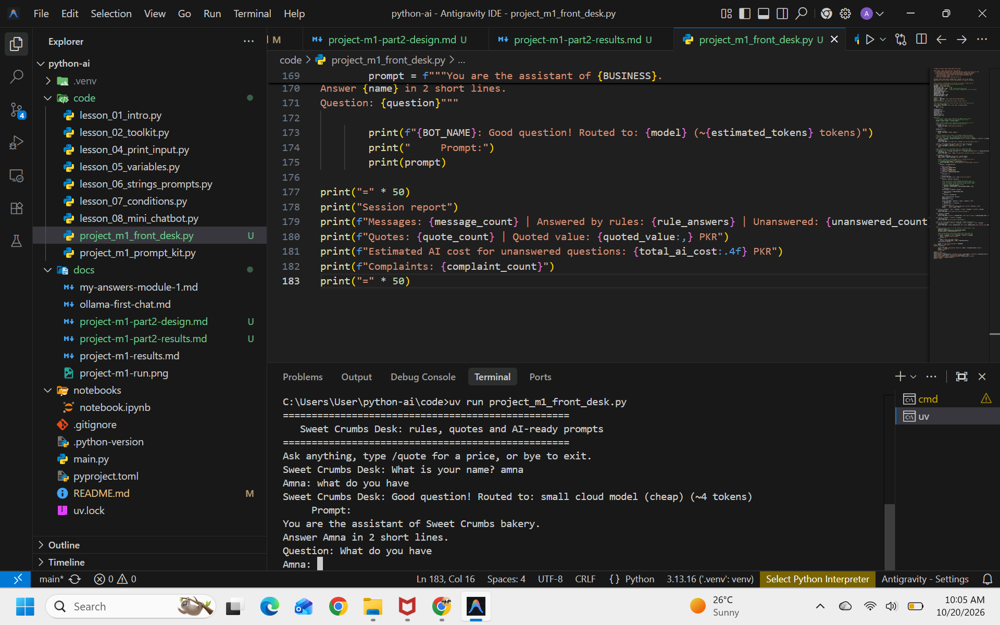

Name: Amna
course: AI for everyone


| # | Intent | What the user wants | Keywords to look for | Reply |
|---|--------|--------------------|----------------------|-------|
| 1 | Human handover | Talk to a person | `agent`, `human` | Connecting you to a human... (chat ends) |
| 2 | Complaint | Report a problem | `late`, `complaint`, `rude`, `bad`, `wrong`, `refund`, `problem` | Sorry about that. The clinic manager will call you today. |
| 3 | Greeting | Say hello | first word is `hi`, `hello`, `salam`, `hey` | Hello! How can I help you? |
| 4 | Timings | Opening hours | `timing(s)`, `time`, `open`, `close`, `hours` | Open 10 am to 8 pm, Monday to Saturday. |
| 5 | Fees | Consultation price | `fee`, `fees`, `price`, `cost`, `charges` | Consultation fee is 2,000 PKR. |
| 6 | Location | Where the clinic is | `where`, `location`, `address`, `directions` | 12 Garden Road, near the main market. |
| 7 | Appointment | Book a visit | `appointment`, `book`, `booking`, `schedule` | Call 0300-1234567 or reply with a preferred day and time. |
| 8 | Fallback | Anything else | none matched | Counted as unanswered; prints the AI prompt for Module 2. |


# Module 1 Project: Sweet Crumbs Front Desk

A chat front desk for a local bakery: it answers common questions for free with rules, gives exact price quotes with discounts and delivery, prepares AI-ready prompts for everything else, and ends with a session report for the owner.

## Run

```
uv run code/project_m1_front_desk.py
```

Type a question, `/quote` for a price, or `bye` to exit.

## Screenshot



## Why the owner would pay for it

Staff stop typing the same answers (hours, delivery, prices), quotes are always calculated the same way (no price mistakes), and the report shows how many questions the rules could not answer, so the owner knows what customers really ask.
Estimate to fill in with the real client: if staff spend about __ minutes a day on repeat questions, that is about __ hours a month saved.

## Files

- `code/project_m1_front_desk.py`: the front desk
- `docs/project-m1-part2-design.md`: intents, business rules and the rule test table
- `docs/project-m1-part2-results.md`: AI test results (to be filled in after running Ollama)
- `docs/project-m1-part2-run.png`: screenshot of a full session